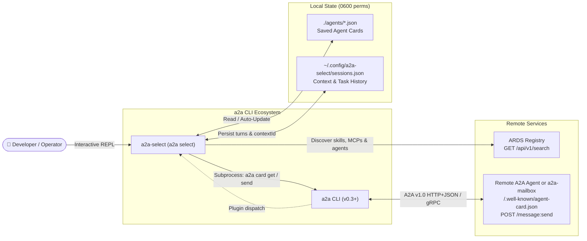
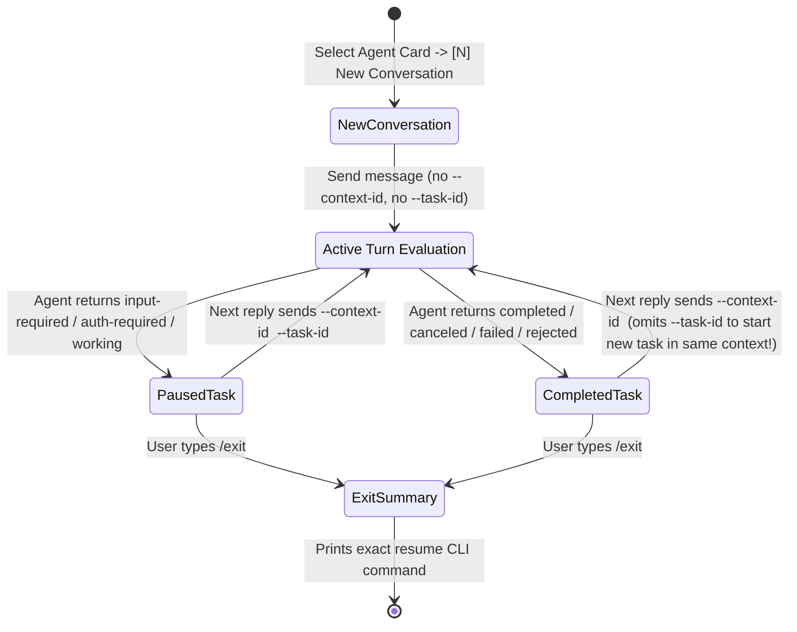
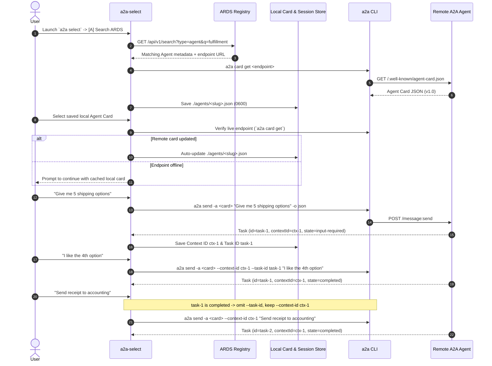

# a2a-select

[](https://github.com/msampathkumar/a2a-select/releases)
[](https://go.dev/)
[](https://a2a-protocol.org/)
[](./LICENSE)

**`a2a-select`** is an interactive **Agent Card selector, ARDS Registry explorer, and stateful multi-turn A2A conversation client** built on top of the [`a2a` CLI](https://github.com/a2aproject/a2a).

Instead of manually copying `--agent-card`, `--context-id`, and `--task-id` flags on every turn, `a2a-select` gives you a human-friendly interactive session that automatically verifies and refreshes saved Agent Cards, manages the A2A Task & Context state machine across multi-turn conversations, and prints exact resume commands whenever you pause or exit.

It works both as a standalone binary (`a2a-select`) and as a native **`a2a` Command Plugin** (`a2a select`), and pairs seamlessly with [**`a2a-mailbox`**](https://github.com/msampathkumar/a2a-mailbox).

---

## Architecture & Workflows

### 1. System Architecture



### 2. A2A Task & Context Lifecycle State Machine

In the A2A protocol, **a completed task (`completed`, `failed`, `canceled`, `rejected`) cannot be restarted**, whereas a paused task (`input-required`, `auth-required`) must be continued with the same `taskId`. `a2a-select` handles this automatically on every turn:



### 3. End-to-End Discovery, Auto-Update & Multi-Turn Sequence



---

## Installation

### Prerequisites
- [`a2a` CLI](https://github.com/a2aproject/a2a) (`v0.3.0+`) installed on your `PATH`.
- Go `1.24+` (zero external dependencies).

### Install via `go install` or `Makefile`

```bash
git clone https://github.com/msampathkumar/a2a-select.git
cd a2a-select
make install
```

### Enable as a Native `a2a` Command Plugin

```bash
a2a plugin set-enabled true
a2a plugin list
```

Output:
```text
Command plugins: enabled
NAME     VERSION  DESCRIPTION                                                                     PATH
mailbox  0.1.0    Executor-less A2A inbox server backed by local DB, tk tickets, or Pub/Sub       /opt/homebrew/bin/a2a-mailbox
select   0.1.0    Interactive agent card selector, ARDS discovery, and stateful A2A chat session  /opt/homebrew/bin/a2a-select
```

---

## Usage & Interactive Walkthrough

### Launch Interactive Selector
```bash
a2a select
# or directly:
a2a-select
```

```text
╭──────────────────────────────────────────────────────────────╮
│  a2a-select — Interactive Agent Selector & Stateful Chat     │
╰──────────────────────────────────────────────────────────────╯

=== Local Saved Agent Cards (./agents) ===
  [1] Osaka Fulfillment Agent      v1.1.0     http://127.0.0.1:8080  (osaka-fulfillment-agent.json)
  [2] A2A Mailbox (tk backend)     v0.1.0     http://127.0.0.1:8085  (a2a-mailbox.json)

Actions:
  [1-2] Select a local Agent Card
  [A]   Search ARDS Registry (skills, tools, APIs, or A2A agents)
  [F]   Fetch & save an Agent Card from URL
  [Q]   Quit
```

### Multi-Turn Chat Session & Exit Resume Summary
```text
You > Give me 5 shipping options for order #42

Agent (Osaka Fulfillment Agent):
Here are 5 options: [1] Air [2] Sea [3] Rail [4] Express Drone [5] Courier. Which one do you want?
  ┌─ Turn Details ─────────────────────────────────────────────
  │ Task ID:     task-101
  │ Task Status: input-required
  │ Context ID:  ctx-900
  └────────────────────────────────────────────────────────────

You > I like the 4th option, please book Express Drone
  ↳ Continuing active task task-101 in context ctx-900 ...

Agent (Osaka Fulfillment Agent):
Option #4 (Express Drone) confirmed and booked!
  ┌─ Turn Details ─────────────────────────────────────────────
  │ Task ID:     task-101
  │ Task Status: completed
  │ Context ID:  ctx-900
  └────────────────────────────────────────────────────────────

You > /exit

--- Session Paused ---
  Agent:        Osaka Fulfillment Agent
  Context ID:   ctx-900
  Last Task ID: task-101 (status: completed)
Would you like to restart/continue this conversation right now? [y/N]: n

=== Continue This Conversation Later ===
1. Resume interactive chat in a2a-select:
   a2a-select --card ./agents/osaka-fulfillment-agent.json --context-id ctx-900

2. Or send the next turn directly with the a2a CLI:
   a2a send -a ./agents/osaka-fulfillment-agent.json --context-id ctx-900 "<your follow-up message>"
```

---

## CLI Flags & In-Chat Commands

| Flag | Default | Description |
| :--- | :--- | :--- |
| `--cards-dir` | `./agents` (`$A2A_SELECT_CARDS_DIR`) | Directory containing saved local Agent Card JSON files |
| `--sessions-file` | `~/.config/a2a-select/sessions.json` | File path for storing conversation history and Context IDs |
| `--card` | *(interactive)* | Open a specific local Agent Card JSON file directly |
| `--context-id` | *(interactive)* | Resume a specific conversation `contextId` directly |
| `--task-id` | *(optional)* | Continue a specific paused `taskId` (`input-required`) |
| `--ards-url` | `http://127.0.0.1:8000` (`$ARDS_URL`) | Default ARDS Registry base URL |
| `--a2a-bin` | `a2a` (`$A2A_BIN`) | Path or name of the `a2a` CLI binary |
| `--auth` | `$A2ACLI_AUTH` | Authorization credential passed through to `a2a` commands |
| `--version` | `false` | Print version information (`a2a-select 0.1.0`) and exit |

| In-Chat Command | Description |
| :--- | :--- |
| `/status` | Display current Agent Card path, `Context ID`, last `Task ID`, and task state |
| `/tasks` | Query the remote agent for all tasks belonging to the current `Context ID` |
| `/new` | Start a brand-new `Context ID` with the current agent |
| `/help` | Show available in-chat slash commands |
| `/exit` or `/quit` | Pause session, optionally restart immediately, and print resume commands |

---

## Testing & Black-Box Evals

Run the full unit, integration, and compiled-binary black-box evaluation suite with the Go race detector enabled:

```bash
make test
# or:
go test -v -count=1 -race ./...
```

---

## License

Licensed under the [Apache License, Version 2.0](./LICENSE).
